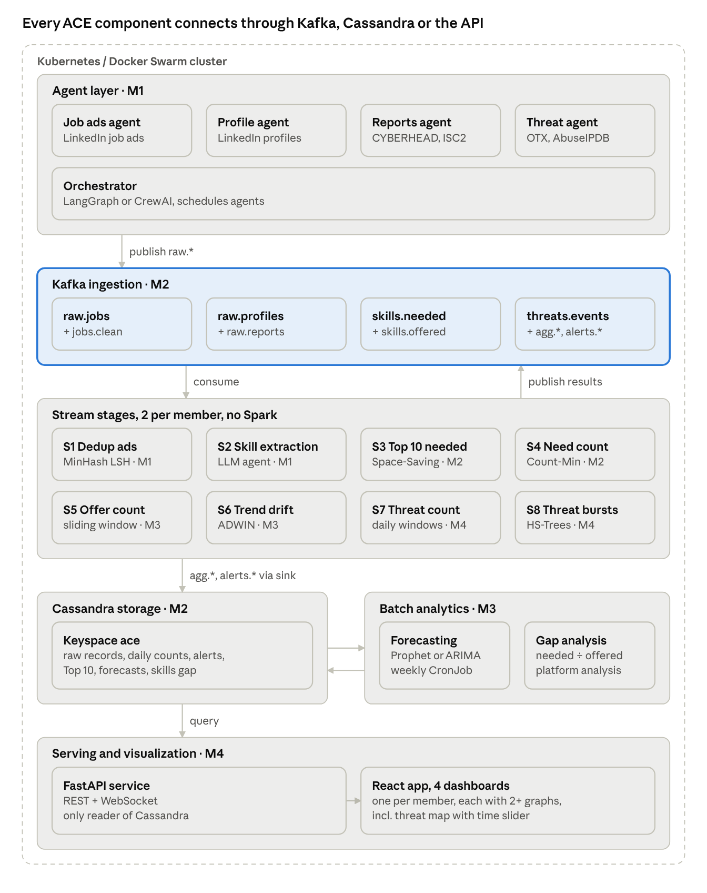

# ACE – Agentic Cybersecurity Education Optimizer

ACE collects cybersecurity job ads, professional profiles, education programmes, workforce reports and threat data with separate AI agents, streams them through Kafka, stores them in Cassandra, and shows skill Demand, skill Supply, the Skills Gap and threats per country on choropleth maps and dashboards. It is a European counterpart to [CyberSeek](https://www.cyberseek.org).

Joint project for the **Open Source Technologies (OST)** and **Stream Mining (SM)** courses, supervised by Imre Lendak.

- Architecture and work plan: [docs/ARCHITECTURE.md](docs/ARCHITECTURE.md)
- How we work (branches, pull requests): [CONTRIBUTING.md](CONTRIBUTING.md)



## Team

| Member | Area | Stream stages | Dashboard |
| --- | --- | --- | --- |
| M1 – Singh Multani Gurinder | Job ads and profile agents; Skill Taxonomy | S1 near-duplicate filter, S2 skill extraction | Role explorer (career pathway) |
| M2 – Ullah Asad | Kafka, Cassandra, sink, deployment, monitoring | S3 Top 10 (Space-Saving), S4 Demand frequency (Count-Min) | Skills demand |
| M3 – Bailey Kelen | Batch forecasting, Skills Gap, LLM module | S5 Supply frequency (exponential histograms), S6 drift detection (ADWIN) | Supply, gap and forecast |
| M4 – Roomi Babar Ali | API and web app shell, Europe map, threat agent | S7 threat frequency, S8 burst detection (Half-Space Trees) | Threat landscape |
| M5 – Richartz Lena | Education, workforce and platform analysis agents | S9 emerging skills (Lossy Counting), S10 hiring companies (HyperLogLog) | Education and workforce |

## Repository layout

```
agents/          all agents (one subfolder per agent, owned by its member)
streaming/       all stream stages S1–S10, one folder per stage
storage/cql/     M2  Cassandra schema
batch/           M3  forecasting and gap analysis jobs
api/             M4  FastAPI service (each member adds own endpoints)
dashboard/       M4  React app shell + Europe map; one dashboard per member
deploy/          M2  Kafka topic setup, Kubernetes manifests
shared/schemas/  all Kafka message contracts (JSON Schema) and topics.csv
shared/taxonomy/ all Skill Taxonomy: skills, certifications, ECSF roles (M1 merges)
shared/python/   M2  shared code: stage base, contracts; skill matcher (M1)
docs/            architecture, report, slides
```

## Running the project

Requirements: a current Docker Desktop and Git. The start command was tested with Docker Compose v5.7.0; older versions may reject the `include:` block in `docker-compose.yml` or stop `--wait` with an error when `kafka-init` and `cassandra-init` finish. Check yours with `docker compose version` and update Docker Desktop if it is older. The commands work the same in PowerShell, bash and zsh.

### First time only

```bash
git clone https://github.com/asad972/Agentic-cybersecurity-education-optimizer--ACE.git
cd Agentic-cybersecurity-education-optimizer--ACE
cp .env.example .env          # add your own API keys; never commit .env
```

### Start

Start Docker Desktop first, then run from the repository root:

```bash
docker compose up -d --build --wait
```

This one command builds and starts the whole stack in the right order:

1. Kafka and Cassandra
2. `kafka-init` and `cassandra-init`, which create the topics and the tables and then stop
3. the sink, which copies Kafka topics into Cassandra, and the stream stages, once the topics exist
4. the API, once the tables exist
5. the dashboard, once the API is healthy

`--wait` returns when every service is running or finished. The first start takes a few minutes, because Docker downloads the images and Cassandra needs 1–2 minutes to start.

### Check that it is running

```bash
docker compose ps -a
```

All services should show `Up` or `healthy`. `kafka-init` and `cassandra-init` show `Exited (0)`, which is normal: they finished their setup.

| Service | Address |
| --- | --- |
| Dashboard | http://localhost:5173 |
| API (interactive docs) | http://localhost:8000/docs |
| API readiness | http://localhost:8000/ready shows `"database": "connected"` |
| Kafka UI | http://localhost:8080 |
| Kafka (from your machine) | `localhost:9092` |
| Kafka (from other containers) | `kafka:29092` |
| Cassandra (CQL) | `localhost:9042`, keyspace `ace` |

The dashboard and API ports can be changed: set `ACE_DASHBOARD_PORT` or `ACE_API_PORT` in your shell before the start command, and use that port in the addresses above. The dashboard in Docker always calls the API on port 8000, so only move the API when you don't need the dashboard.

The stream stages start with the rest, as three Flink jobs: `s7-threat-frequency` (S7 hourly and daily), `s8-threat-bursts` and `job-stages` (S1–S6, S9 and S10). Each job is one Java process of about 700 MB, so they add about 2 GB to Kafka, Cassandra (1 GB heap), the sink, the API and the dashboard. Make sure Docker may use enough memory for all of it (on Windows with WSL 2, the limit is in `.wslconfig`; on macOS, under Settings > Resources). If a stage container keeps restarting with exit code 137, it ran out of memory. Their checkpoints are on the `stage-checkpoints` volume, so a restarted stage continues where it stopped (see [shared/python/README.md](shared/python/README.md#running-a-stage-on-kafka)).

The dashboard shows numbers only after data has passed through the pipeline. The agents run separately, except the threat agent, which starts with the rest once `COMPOSE_PROFILES=live` is in `.env`; see the README in each folder under `agents/`.

### After changing code

Run the start command again. `--build` rebuilds only the images whose files changed, and Compose restarts only the services that changed.

### Logs

```bash
docker compose logs -f api              # follow one service (Ctrl+C to stop)
docker compose logs cassandra-init      # did the schema load?
docker compose logs kafka-init          # were the topics created?
```

### Stop

```bash
docker compose down           # stop everything, keep the data
docker compose down -v        # stop everything and delete the stored data
```

### Run one part alone

The API and the dashboard keep their own compose files, so you can work on one without the rest: see [api/README.md](api/README.md) and [dashboard/README.md](dashboard/README.md). Those files publish the same ports as the full stack (8000 and 5173, or `ACE_API_PORT` and `ACE_DASHBOARD_PORT` if you set them), so first stop only the part you replace and leave the rest running:

```bash
docker compose stop dashboard       # before starting the dashboard alone; it uses the full stack's API
docker compose stop api dashboard   # before starting the API alone; the full stack's dashboard only reaches the full stack's API
```

To go back, stop the part you started alone, then run the start command again.

### Troubleshooting

- **`container name "/ace-kafka" is already in use`:** containers from an older setup still exist. List them with `docker ps -a`, remove the old ones with `docker rm -f <name>`, then start again.
- **`port is already allocated`:** another program, or the API or dashboard started on its own, is using that port. Stop it, or stop that part of the full stack before starting it alone (see [Run one part alone](#run-one-part-alone)).
- **The dashboard opens but stays empty:** check http://localhost:8000/ready. If it does not say `connected`, Cassandra is still starting; wait a minute and reload.

## Key dates

| Date (2026) | Milestone |
| --- | --- |
| Oct 19 | Architecture and per-member work plan due |
| Nov 26, 12:00 CET | Early submission (secures December exam slots) |
| Nov 30 – Dec 4 | Early project defenses |
| Dec 6, 12:00 CET | Late submission deadline |
