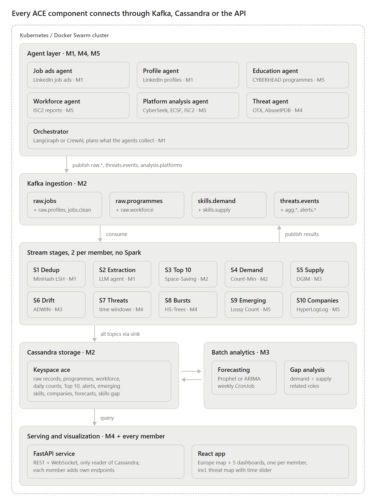
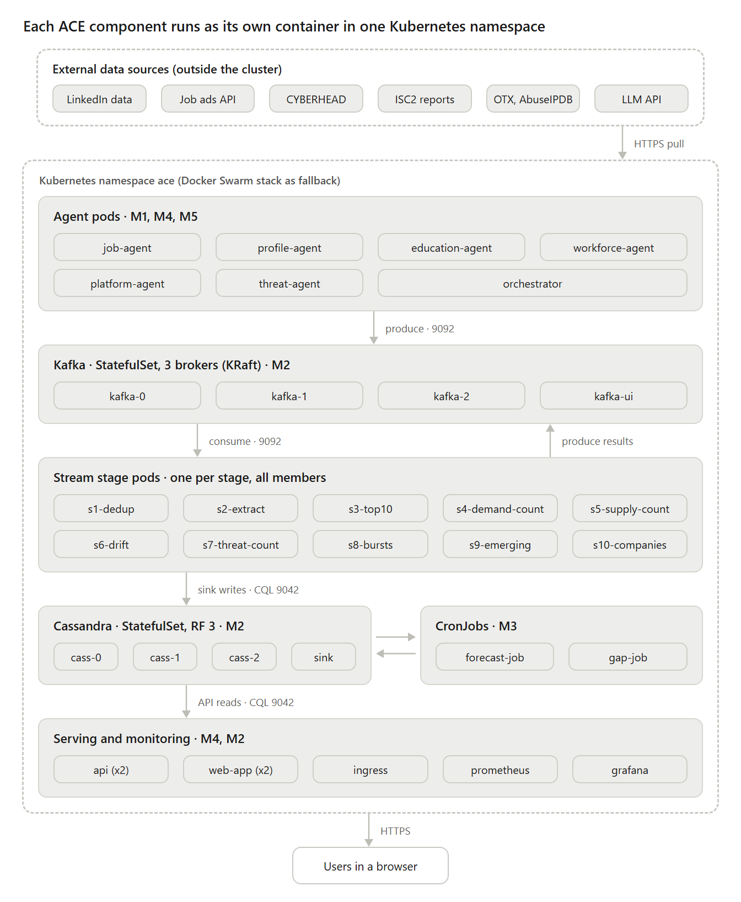
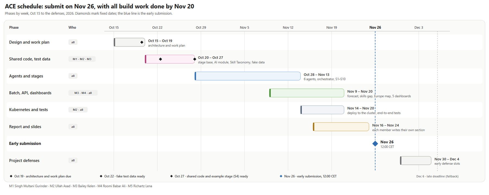

# ACE – System Architecture

Last updated: Oct 15, 2026

> **Status: proposal, not yet agreed by the team.** The Oct 15 changes are listed for discussion in [design-update-2026-10-15.md](design-update-2026-10-15.md). Until the team agrees, treat this document as a draft.

## Overview

ACE is an agentic, event-driven platform that collects cybersecurity job ads, professional profiles, education programmes, workforce reports and threat data, then shows skill Demand, skill Supply, the Skills Gap and threats per country on maps and dashboards. It is a European counterpart to [CyberSeek](https://www.cyberseek.org).

**Key terms:** **Demand** is how often job ads ask for a Skill. **Supply** is how many profiles in a country show a Skill over the last 365 days. The **Skills Gap** is Demand ÷ Supply. A **Skill**, **Certification** or **Role** is always an entry in the Skill Taxonomy. A **Country** is an ISO two-letter code; `EU` is a **Region**, used only in forecasts.

The system has six layers. Each layer is a separate containerized service, and the layers connect only through Kafka topics, Cassandra tables or the REST API:

1. **Agent layer**: separate AI agents collect raw data, extract normalized skills and analyse similar platforms.
2. **Ingestion layer**: Kafka carries all events. Every agent publishes to Kafka; there are no exceptions.
3. **Stream layer**: stream-mining pipelines compute Top 10 lists, frequency counts, emerging skills, hiring companies, and drift and burst alerts per country.
4. **Storage layer**: Cassandra stores raw records, aggregates and forecasts.
5. **Batch layer**: a forecasting model predicts skill Demand per country and for Europe, and a gap job compares Demand with Supply.
6. **Serving layer**: an API and a web app with a CyberSeek-style Europe map, a role explorer, per-member dashboards and a world threat map with scroll-back.

**Mandatory constraints from the brief:** Kafka for real-time ingest, Cassandra for storage, Docker Swarm or Kubernetes for deployment, and no Apache Spark for analysis.

## Course requirements coverage

| Requirement (from the brief) | ACE design |
| --- | --- |
| Agentic solution, separate AI agents per sub-task | 6 agents (job ads, profiles, education, workforce, threats, platform analysis) + skill extraction, directed by a planning orchestrator that decides what to collect |
| Datasets: LinkedIn job ads and profiles, CYBERHEAD, ISC2 | All four, plus public threat-intelligence feeds for the threat map |
| Skills needed vs skills offered | Demand (job ads) vs Supply (profiles), compared through one shared Skill Taxonomy |
| Kafka, Cassandra, Docker Swarm/Kubernetes, no Spark | Kafka (KRaft), Cassandra, Kubernetes with Swarm fallback, Python stream processing |
| Batch 1: per-country and European skills-need forecasting | Forecasting job on Demand history (Prophet / ARIMA, LightGBM challenger) |
| Pipeline 1: Top 10 skills per country | S3 (Space-Saving) |
| Pipeline 2: skills-need frequency on a choropleth | S4 (Count-Min Sketch) |
| Pipeline 3: skills-offered frequency on a choropleth | S5 (exponential histograms) |
| World threat choropleth with scroll-back | S7 + S8 + Threat landscape dashboard |
| Additional dashboards | 5 member dashboards + shared Europe map |
| Something similar to CyberSeek | Europe map with metric switch, Top 10 skills and certifications, Skills Gap, role explorer (career pathway) |
| Higher grade: analyse similar platforms | Platform analysis agent compares CyberSeek, ENISA ECSF tools and the ISC2 Workforce Study |
| Higher grade: research papers | Space-Saving, Count-Min Sketch, MinHash LSH, exponential histograms, ADWIN, Half-Space Trees, Lossy Counting, HyperLogLog |

## Architecture at a glance



Data flows top to bottom: agents publish to Kafka, pipelines aggregate back into Kafka, a sink writes everything to Cassandra, batch jobs read history and write forecasts back, and the API serves everything to the web app.

## CyberSeek comparison

ACE mirrors CyberSeek's two main tools for Europe:

| CyberSeek | ACE equivalent |
| --- | --- |
| Heat map coloured by job openings, workforce or supply/demand ratio | **Europe map** with a metric switch: job ads, Demand, Supply, Skills Gap, education programmes, threats |
| Top skills, certifications and job titles per state | Top 10 Skills and Top 10 Certifications per Country (S3) |
| Supply/demand ratio | Skills Gap per Skill and Country |
| Career pathway (roles, skills, certifications, feeder roles) | **Role explorer** built on the 12 ECSF role profiles: top Skills and Certifications, Demand per Country, education programmes and related roles |

## Data sources and agent layer

Each sub-task runs as its own AI agent in its own container, owned by the member who uses its data. Kubernetes keeps every agent running (starts, restarts and scales the containers); the orchestrator (M1) decides what the agents collect. Every agent publishes to Kafka and never writes to Cassandra directly.

| Agent | Owner | Input source | Output topic | What it does |
| --- | --- | --- | --- | --- |
| Job ads agent | M1 | LinkedIn job ads (public datasets), job APIs | `raw.jobs` | Replays ads in `posted_date` order and tags country, date and title |
| Profile agent | M1 | LinkedIn professional profiles (public or anonymized datasets) | `raw.profiles` | Replays profiles and strips personal identifiers |
| Education agent | M5 | ENISA CYBERHEAD database | `raw.programmes` | Collects cybersecurity higher-education programmes per country and maps each to ECSF roles with an LLM |
| Workforce agent | M5 | ISC2 annual workforce reports | `raw.workforce` | Parses report PDFs and tables into workforce figures per country and year |
| Threat agent | M4 | Public threat-intelligence feeds (AlienVault OTX, AbuseIPDB) | `threats.events` | Collects live threat events and geolocates them to a country |
| Skill extraction agent (S2) | M1 | `jobs.clean`, `raw.profiles` | `skills.demand`, `skills.supply` | LLM reads the text and returns Skills, Certifications and an ECSF role, all mapped to the Skill Taxonomy |
| Platform analysis agent | M5 | CyberSeek, ENISA ECSF tools, ISC2 Workforce Study | `analysis.platforms` | LLM compares platform features and publishes a structured comparison |

**Skill Taxonomy:** every Skill, Certification and role is an entry in a closed, versioned list in [`shared/taxonomy/`](../shared/taxonomy/), derived from the [European Cybersecurity Skills Framework (ECSF)](https://www.enisa.europa.eu/topics/education/european-cybersecurity-skills-framework) with NICE cross-references. Mentions that match no entry are counted as Unmapped Skills for pipeline health and never shown on maps; S9 lists the most frequent ones as candidates for the next taxonomy version. The whole team builds the first version together: each member adds the Skills and Certifications for their own area, and M1 reviews and merges them. After that, M1 maintains it and changes are agreed by the whole team.

**Replay in event time:** job ads and profiles come from static datasets, so their agents replay them into Kafka in date order, and every window uses event time, not arrival time. Threat events are live.

**Geography:** Demand and Supply are measured for the Skills Scope (EU27, EEA, UK and Switzerland); threats are measured worldwide. Countries are always ISO 3166-1 alpha-2 codes (`GR`, `GB`, never `EL`, `UK`). `EU` is a Region used only in forecasts, never in a `country` field.

**Orchestration:** the orchestrator is the planning agent, built with LangGraph or CrewAI in Python. Every 6 hours it reads coverage from Kafka (job ads per country from `agg.demand_daily`, programmes from `raw.programmes`, threats from `agg.threats_daily`, rejected messages from `errors.invalid`), finds gaps such as "few Job Ads for PL", and uses the LLM module to choose from a fixed list of actions that live sources can perform:

| Action | Agent | Limit per task |
| --- | --- | --- |
| Fetch job ads for a country from the job API | Job ads agent | 10 pages |
| Refresh education programmes for a country | Education agent | 1 country |
| Refresh threat events for a country | Threat agent | 24 hours of events |
| Rerun the platform comparison | Platform analysis agent | 1 run per week |

It publishes at most 5 tasks per run to `tasks.collect`, each with a one-sentence reason. Agents refuse any action not on the list. The replayed datasets are fixed files, so the orchestrator never asks the replay for more data. If the LLM is unavailable or over budget, fixed rules choose the same actions. Every task and its reason is stored in `orchestrator_decisions` and shown on a "What the orchestrator decided" panel next to pipeline health. Each agent is a separate process, so it can be scaled and restarted on its own.

## Ingestion layer (Kafka)

Kafka is the only path into the system. Messages are JSON, validated against schemas in [`shared/schemas/`](../shared/schemas/). Topics are keyed by country code, so all events for one country land in the same partition and stay in order. The list of topics, with each topic's schema and key, is kept in one file, [`shared/schemas/topics.csv`](../shared/schemas/topics.csv), which both the Python code and the topic setup script read.

| Topic | Producer | Consumers | Key | Schema |
| --- | --- | --- | --- | --- |
| `raw.jobs` | Job ads agent | S1 | country | `raw_job` |
| `raw.profiles` | Profile agent | S2, sink | country | `raw_profile` |
| `raw.programmes` | Education agent | Sink, orchestrator | country | `raw_programme` |
| `raw.workforce` | Workforce agent | Sink | country | `raw_workforce` |
| `jobs.clean` | S1 | S2, sink | country | `raw_job` |
| `skills.demand` | S2 | S3, S4 | country | `skills_demand` |
| `skills.supply` | S2 | S5 | country | `skills_supply` |
| `threats.events` | Threat agent | S7 | country | `threat_event` |
| `agg.top10_demand` | S3 | Sink, S6 | country | `agg_top10` |
| `agg.demand_daily` | S4 | Sink, S6, orchestrator | country | `agg_count` |
| `agg.supply_daily` | S5 | Sink | country | `agg_count` |
| `agg.threats_hourly` | S7 | Sink, S8 | country | `agg_threats` |
| `agg.threats_daily` | S7 | Sink, orchestrator | country | `agg_threats` |
| `agg.emerging_skills` | S9 | Sink | country | `agg_emerging` |
| `agg.companies_daily` | S10 | Sink | country | `agg_companies` |
| `alerts.drift` | S6 | Sink, API live feed | country | `alert` |
| `alerts.threats` | S8 | Sink, API live feed | country | `alert` |
| `analysis.platforms` | Platform analysis agent | Sink | platform | `platform_analysis` |
| `errors.invalid` | Shared `ace` package (any producer) | Pipeline-health panels, orchestrator | topic | `invalid_message` |
| `tasks.collect` | Orchestrator | Job ads, education, threat and platform analysis agents, sink | agent | `collect_task` |

Example `skills.demand` message:

```json
{
  "event_id": "uuid",
  "source": "linkedin_jobs",
  "country": "HU",
  "posted_date": "2026-10-01",
  "job_title": "SOC Analyst",
  "ecsf_role": "Cyber Incident Responder",
  "skills": ["SIEM", "Incident response", "Python"],
  "certifications": ["CompTIA Security+"],
  "unmapped": ["Splunk dashboards"]
}
```

## Shared code

Everything except the React app is Python, so the code every member needs lives in one package, [`shared/python/ace/`](../shared/python/), installed in every container. It is a shared contract: its owners fix bugs freely, but changes to how it is used are agreed by the whole team.

| Part | What it does | Used by | Owner |
| --- | --- | --- | --- |
| Stage base (`ace.stage`) | Runs a stream stage: consumes, checks message formats, applies event time and the grace period, emits once per window, publishes, and counts late and invalid records. Supports windowed stages (S3, S4, S5, S7, S9, S10) and per-record stages (S1, S2, S6, S8). Each stage supplies only its algorithm. | All 10 stages | M2 |
| Contracts (`ace.contracts`) | Reads [`shared/schemas/topics.csv`](../shared/schemas/topics.csv) (topic, schema, key), validates every message before it is published, and gives every module the topic names. | All agents and stages | M2 |
| Skill matcher (`ace.taxonomy`) | Loads the Skill Taxonomy and maps a mention to a Skill, Certification or Role by exact name or listed alias, ignoring case; anything else is Unmapped. | S2, S3, S4, S5, gap job, education agent, role explorer | M1 |
| LLM module (`ace.llm`) | The only path to an LLM. Switches between a local open-source model (development) and a hosted model (final runs) with one setting, caches answers in the `llm_cache` table so nothing is paid for twice, retries when the provider is busy, checks that answers are valid JSON, and stops at a daily budget (`LLM_DAILY_BUDGET_EUR`). | S2, education agent, platform analysis agent | M3 |
| Replay module (`ace.replay`) | Replays a static dataset into Kafka in event-time order at a set speed (`REPLAY_SECONDS_PER_DAY`), and resumes from the position saved in `replay_position` after a restart. Each agent supplies only how to turn one dataset row into a message. | Job ads agent, profile agent | M1 |

- **Invalid messages** are not dropped: the contracts part publishes them to `errors.invalid` with the reason, and they are counted on the pipeline-health panels.
- **Testing:** the stage base runs either on Kafka or on an in-memory list of records, so every stage is tested with plain lists of fake records and no running Kafka. Every stage ships at least one such test. The LLM module replays recorded answers in tests, so tests never pay for LLM calls.
- **Test data:** a small fake dataset (about 200 job ads and 200 profiles across several countries, one JSON message per line) lives in `shared/testdata/` from **Oct 22**. The replay module plays it like the real dataset, so the whole pipeline runs from the first week, before the real dataset is chosen.
- **Timeline:** the package and one example stage (S4) are ready by **Oct 27**, so all stages start from the same base on Nov 2.
- **LLM provider:** the final choice between a local open-source model and a hosted model is made by the team after comparing extraction quality on the hand-labelled sample. The LLM module supports both, so the choice does not block development.
- **API read helper:** a shared Cassandra read helper for the API endpoints is postponed. M4 decides around Nov 15, once two dashboards exist.

## Stream processing

Ten stream stages, two per member, consume from Kafka and publish their results back to Kafka. Each stage runs in its own container, built with [Quix Streams](https://quix.io/docs/quix-streams/introduction.html) and the [River](https://riverml.xyz) library for the stream-mining algorithms, with no Spark.

| Stage | Member | Input → output | Algorithm | Purpose |
| --- | --- | --- | --- | --- |
| S1 Near-duplicate filter | M1 | `raw.jobs` → `jobs.clean` | MinHash + LSH | Drop job ads reposted on several sites |
| S2 Skill extraction | M1 | `jobs.clean`, `raw.profiles` → `skills.demand`, `skills.supply` | LLM agent + Skill Taxonomy mapping | Turn free text into Skills, Certifications and an ECSF role |
| S3 Top 10 | M2 | `skills.demand` → `agg.top10_demand` | Space-Saving (top-k), mergeable daily summaries | Pipeline 1: Top 10 Skills and Top 10 Certifications per Country over the last 30 days, snapshotted daily |
| S4 Demand frequency | M2 | `skills.demand` → `agg.demand_daily` | Count-Min Sketch, daily tumbling windows | Pipeline 2: Demand heat map, plus job ads per Country per day |
| S5 Supply frequency | M3 | `skills.supply` → `agg.supply_daily` | Exponential histograms (DGIM), 365-day sliding window | Pipeline 3: Supply heat map |
| S6 Demand drift detection | M3 | `agg.demand_daily`, `agg.top10_demand` → `alerts.drift` | ADWIN | Flag Skills whose Demand shifts, which triggers forecast retraining |
| S7 Threat frequency | M4 | `threats.events` → `agg.threats_hourly`, `agg.threats_daily` | Hourly and daily tumbling windows | World threat map with scroll-back |
| S8 Threat burst detection | M4 | `agg.threats_hourly` → `alerts.threats` | Half-Space Trees, one model per Country | Mark unusual threat spikes per country |
| S9 Emerging skills | M5 | `skills.demand` → `agg.emerging_skills` | Lossy Counting over Unmapped Skills, 30-day window | Find new skills employers ask for that the Skill Taxonomy does not have yet |
| S10 Hiring companies | M5 | `jobs.clean` → `agg.companies_daily` | HyperLogLog, mergeable daily sketches | Count distinct companies hiring per Country for the Europe map |

**Rules for every stage**

- **Event time:** windows use the record's own date (`posted_date`, profile date, `observed_at`), never arrival time.
- **Grace period:** a window stays open 1 hour of event time after it ends for job ads and profiles, and 15 minutes for threats. Records arriving later are dropped and counted in a `late_records_total` metric for the pipeline-health panels.
- **Emit once:** a window's result is published once, when it closes (`.final()` in Quix Streams). Sink writes are idempotent upserts, so a replay never creates duplicate rows.
- **State:** stage state is kept in Kafka changelog topics, so a restarted stage continues where it stopped.

**Stage notes**

- **S3:** Space-Saving keeps one summary per (Country, day); summaries are mergeable, so the 30-day Top 10 is the merge of the last 30 daily summaries. It runs separately for Skills and for Certifications.
- **S4:** one Count-Min Sketch per (Country, day) window. When the window closes, the stage queries the sketch for every Skill Taxonomy entry, so the taxonomy is the key set. It also emits the plain count of job ads per Country per day for the Europe map.
- **S5:** Supply is a stock, not a flow: a profile has no posting date, so counting profiles per day would only show when the dataset was collected. It counts Profiles per (Country, Skill) over the last 365 days of profile dates, using exponential histograms to keep memory bounded, and emits the count as of each day.
- **S6:** one ADWIN detector per (Country, Skill) for Skills that have appeared in that Country's Top 10 at least once, plus one per Skill for the EU-wide sum. EU-level drift triggers early forecast retraining; Country-level drift shows as alerts.
- **S8:** features are log-scaled hourly counts per threat type plus hour-of-day. Each Country has its own model, so "unusual" means unusual for that Country.
- **S9:** Lossy Counting keeps every Unmapped mention whose count may be above a support threshold, with a known maximum error, in bounded memory. Each day it emits the most frequent mentions per Country over the last 30 days. M1 reviews them when updating the Skill Taxonomy; they are never shown on maps.
- **S10:** one HyperLogLog sketch of company names per (Country, day). Sketches are mergeable, so the 30-day count is the merge of the last 30 daily sketches. Job ads with no company are counted separately, so missing data stays visible. This needs a company field in the job-ads dataset, checked during dataset selection.

## Storage (Cassandra)

One **sink service** (owned by M2) consumes the topics listed below and writes them to Cassandra. For each topic it has one small function that turns a message into rows for each target table, so the row-splitting rules are tested like any other code; a ConfigMap only switches topics on and off. It is the only writer for stream data. Tables are designed query-first, one table per screen or question, and each query reads a single partition where possible. When two screens need the same data in different shapes, the sink writes it to both tables. Everything lives in keyspace `ace`, with replication factor 3 in the cluster. The schema is in [`storage/cql/schema.cql`](../storage/cql/schema.cql).

Counts use `kind` (`skill`, `certification` or `role`) and `item` (the taxonomy entry), so one set of tables serves Skills, Certifications and ECSF roles.

| Table | Written from | Partition key | Clustering key | Answers |
| --- | --- | --- | --- | --- |
| `job_ads_raw` | `jobs.clean` | (country, month) | posted_date, event_id | Raw de-duplicated job ads, used for retraining |
| `profiles_raw` | `raw.profiles` | (country, month) | event_id | Raw anonymized profiles |
| `education_programmes` | `raw.programmes` | country | programme_id | Programmes per country and the ECSF roles they teach |
| `workforce_baseline` | `raw.workforce` | country | year | Workforce figures per country |
| `job_ads_by_day` | `agg.demand_daily` | day | country | Europe map: job ads per country |
| `demand_by_day` | `agg.demand_daily` | (country, day) | kind, item | Country panel: Demand for every item on one day |
| `demand_map` | `agg.demand_daily` | (kind, item, day) | country | Europe map: Demand for one item across countries |
| `demand_trend` | `agg.demand_daily` | (country, kind, item) | day | Time series for one item, input to forecasting and the role explorer |
| `supply_by_day` | `agg.supply_daily` | (country, day) | kind, item | Country panel: Supply as of one day |
| `supply_map` | `agg.supply_daily` | (kind, item, day) | country | Europe map: Supply for one item across countries |
| `top10` | `agg.top10_demand` | (country, day, kind) | rank | Top 10 Skills or Certifications for a country, with scroll-back |
| `threats_by_day` | `agg.threats_daily` | day | country, threat_type | World threat map for one day (scroll-back) |
| `threats_by_hour` | `agg.threats_hourly` | (country, day) | hour, threat_type | Threat line chart for one country |
| `emerging_skills` | `agg.emerging_skills` | (country, day) | mention | Emerging skills list on the Education and workforce dashboard |
| `companies_by_day` | `agg.companies_daily` | day | country | Europe map: hiring companies per country |
| `alerts` | `alerts.*` | (country, day) | created_at, alert_type, subject | Drift (S6) and burst (S8) alerts |
| `platform_analysis` | `analysis.platforms` | platform | feature | Feature comparison of similar platforms |
| `forecasts` | Forecast job | (region, skill) | target_month | Forecast values and confidence band |
| `skills_gap` | Gap job | (country, month) | skill | Demand vs Supply per Skill |
| `role_relations` | Gap job | role | related_role | Related ECSF roles for the role explorer |
| `llm_cache` | LLM module | (task, input_hash) | – | Cached LLM answers, so nothing is paid for twice |
| `replay_position` | Replay module | dataset | – | Where each dataset replay stopped, so a restart resumes |
| `orchestrator_decisions` | `tasks.collect` | day | created_at, task_id | What the orchestrator decided and why |

Raw tables use a time-to-live (TTL) of 2 years. Aggregate tables are kept with no expiry.

## Batch processing

Batch jobs run as scheduled containers (Kubernetes CronJobs), read from Cassandra, and write their results back to Cassandra. They use pandas and scikit-learn, not Spark.

**Batch 1: Skill Demand forecasting**

- Input: `demand_trend` for `kind = skill`, summed to monthly counts per Country. The `EU` Region forecast is trained on the sum across EU countries.
- Models: Prophet or ARIMA/ETS (statsmodels) per Country and Skill, with LightGBM over lag features as a challenger.
- Evaluation: a time-based train/test split (last 3 months held out), scored by MAE and MAPE.
- Output: `forecasts` with a 6–12 month horizon and confidence bands.
- Schedule: retrained weekly, and early when S6 flags EU-level drift.

**Skills Gap job** (monthly): computes Demand ÷ Supply per Skill and Country and writes it to `skills_gap`. The ratio is only computed when Supply is at least `GAP_MIN_SUPPLY` (default 20, set in a ConfigMap); below that, `gap_ratio` is left empty and the dashboard shows "not enough supply data". The same job computes `role_relations`: two ECSF roles are related when their top Skills overlap most.

## Serving and visualization

A FastAPI service is the only reader of Cassandra for the web app. M4 sets up the service and the React app shell; each member writes the endpoints and the page for their own dashboard, so every dashboard is one member's work end to end. A React app calls it over REST, and a WebSocket pushes new alerts. The maps use Leaflet or ECharts with GeoJSON country borders.

| Endpoint | Returns | Used by |
| --- | --- | --- |
| `GET /map?metric=&date=&item=` | One value per country for a metric (`job_ads`, `demand`, `supply`, `gap`, `programmes`, `companies`, `threats`) | Europe map, world threat map |
| `GET /top10?country=&kind=&date=` | Top 10 Skills or Certifications | Country panel, Skills demand dashboard |
| `GET /forecast?region=&skill=` | Forecast series with bands | Forecast dashboard |
| `GET /gap?country=&month=` | Demand vs Supply per Skill | Gap dashboard |
| `GET /threats/hourly?country=&from=&to=` | Hourly threat counts with burst alerts | Threat landscape dashboard |
| `GET /roles` and `GET /roles/{role}?country=` | ECSF roles; for one role its top Skills and Certifications, Demand per country, programmes and related roles | Role explorer |
| `GET /platforms` | Platform feature comparison | Education and workforce dashboard |
| `GET /education?country=` | Programmes per ECSF role and workforce figures for a country | Education and workforce dashboard |
| `GET /emerging?country=&date=` | Most frequent Unmapped Skills over the last 30 days | Education and workforce dashboard |
| `WS /live` | New drift and burst alerts as they arrive | Live feed |

**Europe map (home page, M4):** CyberSeek's main screen for Europe. A choropleth with a metric switch (job ads, Demand, Supply, Skills Gap, education programmes, hiring companies) and an optional Skill filter. Clicking a country opens a panel with its Top 10 Skills and Certifications, workforce figures and alerts.

**Dashboards:** each member builds one dashboard with at least 2 graphs, all in the same React app.

| Dashboard | Member | Graphs |
| --- | --- | --- |
| Role explorer (career pathway) | M1 | One card per ECSF role; top Skills and Certifications for a role (bar); Demand for the role per country (choropleth); education programmes teaching it; related roles |
| Skills demand | M2 | Choropleth of Demand with a Skill filter; Top 10 Skills per country (bar); Top 10 Certifications per country (bar) |
| Supply, gap and forecast | M3 | Choropleth of Supply; Demand vs Supply per Skill (grouped bar); forecast with confidence band (line); drift alerts |
| Threat landscape | M4 | World threat choropleth with a time slider for scroll-back; threats per hour or day with S8 burst markers (line); threat types (bar) |
| Education and workforce | M5 | Education programmes per country next to Demand (choropleth + bar); workforce figures per country (bar); emerging skills (ranked list); hiring companies per country (choropleth); platform comparison table |

Pipeline health (records ingested per source, duplicates removed by S1, extraction success rate, Unmapped Skills, late records, daily LLM spend) is shown as Grafana panels built by M2 as part of monitoring. Next to it, a "What the orchestrator decided" panel (M1) lists recent collection tasks and their reasons.

## Deployment

Every component ships as a Docker image. Development runs on Docker Compose, and the final system runs on Kubernetes, with Docker Swarm as a fallback.



Every box is one Docker container. Kafka and Cassandra run as 3-node StatefulSets, and each stream stage runs as its own pod so it can scale with its topic partitions.

| Component | Kubernetes object | Replicas |
| --- | --- | --- |
| Kafka brokers (KRaft mode) | StatefulSet | 3 |
| Cassandra nodes | StatefulSet | 3 |
| Agents | Deployment, one per agent | 1–2 each |
| Stream stages | Deployment, one per stage | 1–3 (up to the partition count) |
| Sink | Deployment | 2 |
| Forecast and gap jobs | CronJob | Runs on schedule |
| API | Deployment + Service | 2 |
| Web app | Deployment + Ingress | 2 |

- **Configuration:** ConfigMaps hold the topics the sink writes, schedules, `GAP_MIN_SUPPLY`, `LLM_PROVIDER`, `LLM_DAILY_BUDGET_EUR` and `REPLAY_SECONDS_PER_DAY`. Secrets hold API keys, including the LLM key.
- **Monitoring:** Kafka UI to inspect topics, Prometheus and Grafana for service health and pipeline health.
- **CI:** GitHub Actions builds the images and runs tests on every pull request.

## Technology stack

| Layer | Technology | Why |
| --- | --- | --- |
| Agents | Python, LangGraph or CrewAI, a hosted LLM or a local open-source model (Ollama) | Separate agents per sub-task, as the brief requires |
| Ingestion | Apache Kafka (KRaft) | Required by the brief; real-time and replayable |
| Stream processing | Quix Streams, River | Python stream processing on Kafka without Spark; maintained, with event-time windows |
| Storage | Apache Cassandra | Required by the brief; fast time-series writes |
| Batch / ML | pandas, Prophet, statsmodels, LightGBM | Light forecasting stack, no Spark |
| API | FastAPI | Async Python, auto-generated OpenAPI docs |
| Frontend | React, Leaflet or ECharts | Choropleth maps and dashboards |
| Deployment | Docker, Kubernetes or Docker Swarm | Required by the brief |
| CI / monitoring | GitHub Actions, Prometheus, Grafana | Automated builds and service health |

## Per-member work plan, schedule and risks

Each member is responsible for one component, two stream stages, one dashboard and one report section, so each person can be graded on their own work. The shared contracts (Skill Taxonomy, Kafka schemas, Cassandra tables and API endpoints) belong to the whole team, and changes to them are agreed together. A coordinator settles contract changes and runs integration; each member still owns, and is graded on, their own component.

| Member | Component | Stream stages | Dashboard | Report and slides |
| --- | --- | --- | --- | --- |
| M1 | Job ads and profile agents, orchestrator, Skill Taxonomy (review and merge), skill matcher, replay module, fake test data, dataset selection | S1 near-duplicate filter, S2 skill extraction | Role explorer | Datasets section |
| M2 | Kafka, Cassandra, sink, Docker/Kubernetes, CI, monitoring and pipeline-health panels, stage base and contracts | S3 Top 10 (Space-Saving), S4 Demand frequency (Count-Min) | Skills demand | System architecture section |
| M3 | Batch forecasting, Skills Gap job, LLM module | S5 Supply frequency (exponential histograms), S6 drift detection (ADWIN) | Supply, gap and forecast | Testing and experiments section |
| M4 | FastAPI service and React app shell, Europe map, map components, threat agent | S7 threat frequency, S8 burst detection (Half-Space Trees) | Threat landscape | Abstract, introduction, slide deck |
| M5 | Education (CYBERHEAD), workforce (ISC2) and platform analysis agents; proposes the S9 and S10 topics and tables | S9 emerging skills (Lossy Counting), S10 hiring companies (HyperLogLog) | Education and workforce | Related work (similar platforms) |

Every member writes the agents, API endpoints and dashboard page for their own area, adds the Skills and Certifications for their area to the Skill Taxonomy, contributes 2–4 references for their own algorithms, and proofreads the report.

**Schedule**



The plan aims for the Nov 26 (12:00 CET) early submission, which secures December slots for both theory exams. Dec 6 is the fallback.

**Risks**

- **European data coverage:** most public LinkedIn job-ad datasets are US-heavy. Mitigation: M1 checks candidate datasets for rows per country in the Skills Scope, a date field on profiles, and a company field on job ads (needed by S10), by Oct 17. If coverage is thin, the Skills Scope is narrowed to the countries with enough data.
- **LinkedIn access:** scraping breaks LinkedIn's terms and gets blocked. Mitigation: public datasets and job APIs.
- **Personal data in profiles:** names and identifiers are removed at the profile agent, and only skills, country and date are stored.
- **LLM cost and accuracy:** all LLM calls go through one module that caches answers, enforces a daily budget and can switch to a free local model. Extraction results are spot-checked against a hand-labelled sample, and the Unmapped Skills rate and daily LLM spend are tracked.
- **New member catching up:** M5 joined after the design work started. M5 builds against the fake test data from Oct 22, and S9 and S10 depend only on S1 and S2 outputs, so they can start as soon as the stage base is ready.

## References

The course allows 10–15 references, no older than 10 years, with 2–3 exceptions. The foundational algorithm papers below are older, so the report keeps at most 3 of them and cites the recent papers for the rest. Each citation must be checked against the original paper before it goes into the report.

**Recent (2016 or later)**

- ENISA. (2022). *European Cybersecurity Skills Framework (ECSF)*. European Union Agency for Cybersecurity.
- Gomes, H. M., Read, J., Bifet, A., Barddal, J. P., & Gama, J. (2019). Machine learning for streaming data: State of the art, challenges, and opportunities. *ACM SIGKDD Explorations Newsletter, 21*(2), 6–22.
- ISC2. (2024). *ISC2 Cybersecurity Workforce Study*. ISC2.
- Montiel, J., et al. (2021). River: Machine learning for streaming data in Python. *Journal of Machine Learning Research, 22*(110), 1–8.
- Petersen, R., Santos, D., Wetzel, K., Smith, M., & Witte, G. (2020). *Workforce Framework for Cybersecurity (NICE Framework)* (NIST SP 800-181 Rev. 1). NIST.
- Taylor, S. J., & Letham, B. (2018). Forecasting at scale. *The American Statistician, 72*(1), 37–45.
- Zhang, M., Jensen, K. N., Sonniks, S. D., & Plank, B. (2022). SkillSpan: Hard and soft skill extraction from English job postings. In *Proceedings of NAACL 2022*.

**Foundational algorithms (older than 10 years)**

- Agarwal, P. K., Cormode, G., Huang, Z., Phillips, J. M., Wei, Z., & Yi, K. (2013). Mergeable summaries. *ACM Transactions on Database Systems, 38*(4). (S3 30-day merge)
- Bifet, A., & Gavaldà, R. (2007). Learning from time-changing data with adaptive windowing. In *Proceedings of the SIAM International Conference on Data Mining*. (ADWIN, S6)
- Broder, A. Z. (1997). On the resemblance and containment of documents. In *Compression and Complexity of Sequences*. IEEE. (MinHash, S1)
- Cormode, G., & Muthukrishnan, S. (2005). An improved data stream summary: The count-min sketch and its applications. *Journal of Algorithms, 55*(1), 58–75. (S4)
- Datar, M., Gionis, A., Indyk, P., & Motwani, R. (2002). Maintaining stream statistics over sliding windows. *SIAM Journal on Computing, 31*(6), 1794–1813. (Exponential histograms, S5)
- Flajolet, P., Fusy, É., Gandolfi, O., & Meunier, F. (2007). HyperLogLog: The analysis of a near-optimal cardinality estimation algorithm. In *Proceedings of the 2007 Conference on Analysis of Algorithms (AofA)*, DMTCS Proceedings. (S10)
- Manku, G. S., & Motwani, R. (2002). Approximate frequency counts over data streams. In *Proceedings of the 28th International Conference on Very Large Data Bases (VLDB)*, 346–357. (Lossy Counting, S9)
- Metwally, A., Agrawal, D., & El Abbadi, A. (2005). Efficient computation of frequent and top-k elements in data streams. In *ICDT 2005*. Springer. (Space-Saving, S3)
- Tan, S. C., Ting, K. M., & Liu, T. F. (2011). Fast anomaly detection for streaming data. In *Proceedings of IJCAI 2011*. (Half-Space Trees, S8)

**Platforms analysed**

- [CyberSeek](https://www.cyberseek.org): cybersecurity supply and demand heat map and career pathway (US).
- [ENISA ECSF](https://www.enisa.europa.eu/topics/education/european-cybersecurity-skills-framework): European role profiles.
- [ENISA CYBERHEAD](https://www.enisa.europa.eu/topics/education/cyberhead): European cybersecurity higher-education database.
