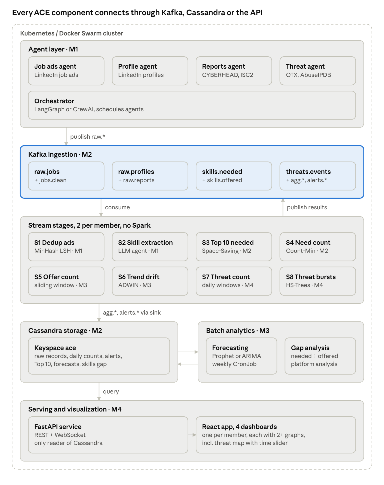

# System architecture

ACE is an event-driven system of loosely coupled services, each in its own
Docker container. Components connect only through Kafka topics, Cassandra
tables or the REST API, so each member can build and test a component alone,
and any data can be replayed through the whole pipeline again.

## Data flow

Agents (2 in Figure 1) collect Job Ads (a German job-ad history, 2015–2026),
Education Programmes (ENISA's CYBERHEAD), workforce figures (ISC2), Threat
Events (OTX and AbuseIPDB) and a comparison of similar platforms. Agents that
read free text share one AI model module with a cache and a daily budget. Ten
stream stages on Apache Flink (4) read from Kafka (3) and publish counts,
rankings and alerts back to it. A sink stores everything in Cassandra (5),
batch jobs (6) add forecasts and the Skills Gap, and a FastAPI service with a
React application (7) shows them. The Profile agent, the live job APIs and the
planning orchestrator are designed but not built yet.

Every Skill, Certification and Role is an entry in one closed Skill Taxonomy
based on the European Cybersecurity Skills Framework (ECSF) (ENISA, 2022); other
mentions are counted as Unmapped Skills. Demand and Supply use the same keys,
so they can be compared.

## Ingestion and stream processing

Agents publish only to Kafka. A durable, replayable log separates producers
from consumers, so a bug fix can reprocess history by reading a topic
again. All 20 topics, with their JSON Schema and key, are listed in one file.
A message that fails its schema goes to `errors.invalid` and is counted.
Topics are keyed by country code, so one Country's events stay in order, and
historical datasets are replayed in date order along the same path as live
data.

The ten stages (Table 1) run as PyFlink jobs on one Flink cluster, which gives
event-time windows, watermarks and checkpointed state on Kafka (Carbone et al., 2017). Each job
saves its state and offsets every 60 seconds, so a restarted job continues
where it stopped.

| Stage | Task | Algorithm |
| --- | --- | --- |
| S1 | Remove near-duplicate Job Ads | MinHash + LSH |
| S2 | Extract Skills, Certifications, ECSF Role | Taxonomy match + AI model |
| S3 | Top 10 Skills and Certifications, 30 days | Space-Saving |
| S4 | Daily Demand per Country | Count-Min Sketch |
| S5 | Supply per Country, 365 days | DGIM (exponential histograms) |
| S6 | Demand drift | ADWIN |
| S7 | Threat counts per hour and day | Tumbling windows |
| S8 | Threat bursts per Country | Half-Space Trees |
| S9 | Emerging Unmapped Skills | Lossy Counting |
| S10 | Distinct hiring companies | HyperLogLog |

Table 1: The ten stream stages, two per team member.

A shared stage base enforces the common rules, so a stage supplies only
its algorithm. Windows use the date inside the record, not the arrival time;
records more than one hour late (15 minutes for threats) are set aside and
counted. The same code also runs as plain Python under the same watermark
rules, so every stage is tested with fake records.

**S3 Top 10** keeps one Space-Saving summary (Metwally et al., 2005) with k = 100 counters per
Country, day and kind (Skill or Certification). A count is at most N/k too
high, here 1% of the N mentions, and every item above that share is sure to be
kept. Two summaries can be merged into one, so when a day closes, the stage merges
it with the 29 days before it and publishes the 30-day Top 10. Memory stays at
30 days × 2 kinds × 100 counters per Country.

**S4 Demand frequency** keeps one Count-Min Sketch (Cormode & Muthukrishnan, 2005) per Country and day,
with depth d = 5 and width w = 2048. An estimate is never below the true count
and, with probability 1 − e^−d (about 99.3%), at most (e/w)·N above it, which
is 0.13% of that day's N mentions. A sketch cannot list its keys, so the closed
taxonomy is what makes it usable: when the day closes, the stage asks the
sketch for every taxonomy entry. The number of Job Ads per day is counted
exactly. Both stages trade a small, bounded error for fixed memory.

## Storage, batch and serving

Cassandra tables are designed from the queries: one table per dashboard
question, partitioned so that a query reads one partition. The sink writes
every message as an upsert on the full primary key and commits the Kafka
offset only afterwards, so a replay or a restarted stage rewrites identical
rows instead of adding duplicates.

Batch jobs use pandas, statsmodels and LightGBM, not Spark. Every week, the
forecast job predicts monthly Skill Demand 12 months ahead per Country and for
Europe, keeping whichever of SARIMA and LightGBM was more accurate on the last
three known months. Every month, the gap job divides Demand by Supply. The
FastAPI service is the only reader of Cassandra for the web application, and
pushes alerts from Kafka to the browser over a WebSocket.

The whole stack starts with one Docker Compose command for development and
runs on Kubernetes (Burns et al., 2016): Kafka and Cassandra as three-node StatefulSets with
replication factor 3, Flink as one JobManager and two TaskManagers, the batch
jobs as CronJobs, and an Ingress in front of the web application and the API.
Prometheus and Grafana show pipeline health, including late and invalid
records and the AI model's daily spend.

## References

Burns, B., Grant, B., Oppenheimer, D., Brewer, E., & Wilkes, J. (2016). Borg,
Omega, and Kubernetes. *Communications of the ACM, 59*(5), 50–57.
<https://doi.org/10.1145/2890784>

Carbone, P., Ewen, S., Fóra, G., Haridi, S., Richter, S., & Tzoumas, K. (2017).
State management in Apache Flink: Consistent stateful distributed stream
processing. *Proceedings of the VLDB Endowment, 10*(12), 1718–1729.
<https://doi.org/10.14778/3137765.3137777>

Cormode, G., & Muthukrishnan, S. (2005). An improved data stream summary: The
count-min sketch and its applications. *Journal of Algorithms, 55*(1), 58–75.
<https://doi.org/10.1016/j.jalgor.2003.12.001>

European Union Agency for Cybersecurity (ENISA). (2022). *European
Cybersecurity Skills Framework (ECSF)*.
<https://www.enisa.europa.eu/topics/education/european-cybersecurity-skills-framework>

Metwally, A., Agrawal, D., & El Abbadi, A. (2005). Efficient computation of
frequent and top-k elements in data streams. In T. Eiter & L. Libkin (Eds.),
*Database Theory – ICDT 2005* (Lecture Notes in Computer Science, Vol. 3363,
pp. 398–412). Springer. <https://doi.org/10.1007/978-3-540-30570-5_27>
