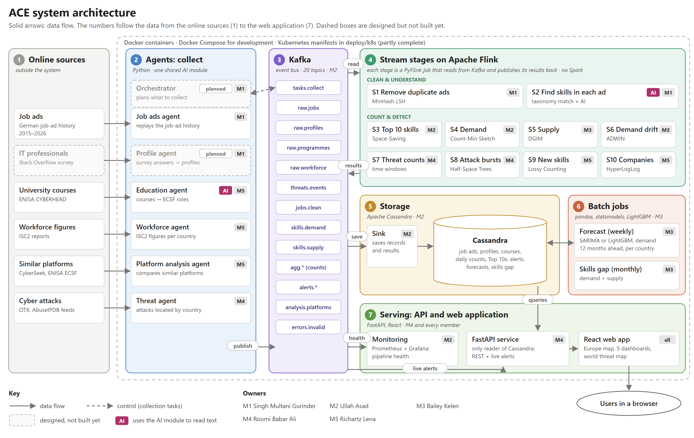

# ACE: Agentic Cybersecurity Education Optimizer

Singh Multani Gurinder, Ullah Asad, Bailey Kelen, Roomi Babar Ali, Richartz Lena

OST & SM joint project, 2026

<!--
HOW TO ADD YOUR PART (delete nothing outside your own markers)

- Write only between the START and END markers that carry your M number.
- Order and page limits follow the professor's brief: abstract ≤ 200 words,
  introduction ≤ 1 page, datasets ≤ 1 page, architecture 2 pages,
  testing/experiments 2 pages, 10–15 references in total.
- Cite in APA style in the text, e.g. (Carbone et al., 2017). No numbered
  citations and no reference list inside a section.
- Put the full APA entry for every source you cite under your name in
  "Reference candidates" at the end. Allowed: conference or journal papers and
  official reports from 2016 or later; no books or course materials. Mark an
  older paper with (OLD) if you think it must stay; the team keeps 2–3 at most.
- Images go in docs/images/ and are linked as images/<file>.png.
- Figures and tables are numbered in reading order: the architecture section
  has Figure 1 and Table 1, so the testing section starts at Table 2.
- Write as the team ("we"), not "M3 did". Who did what goes on the slides.
-->

## Abstract

<!-- M4 START: structured abstract, at most 200 words.
     Background, goal, method, results, impact (one or two sentences each). -->

*To be written by M4.*

<!-- M4 END -->

## 1 Introduction

<!-- M4 START: at most 1 page with the M5 paragraph below.
     The problem, the goal of ACE, and references to relevant papers,
     standards and technologies. -->

*To be written by M4.*

<!-- M4 END -->

<!-- M5 START: 3–4 sentences on similar platforms (CyberSeek, ENISA ECSF),
     shortened from docs/M5-related-work.md. -->

*To be written by M5.*

<!-- M5 END -->

## 2 Datasets

<!-- M1 START: at most 1 page with the M5 paragraph below.
     Each dataset: source, period, size, licence or terms, how it is used,
     and its limits (for example Supply only for DE, GB and FR). -->

We combine two external labor-market sources and one synthetic test dataset to model European cybersecurity Demand and Supply:

- **Historical Job Advertisements (`mischeiwiller/german-job-postings`):** Public German-language job-posting archive hosted on Hugging Face covering 2015–2026 (70,584 records in Apache Parquet format, derived primarily from Bundesagentur für Arbeit listings under the dataset's open research terms on Hugging Face). Our job-ads agent normalizes regional identifiers (`nuts_code` and `region`) into ISO 3166-1 alpha-2 country codes within our European scope, synthesizes job descriptions from pre-annotated ESCO occupation and skill tags (European Commission, 2022), validates records against `raw.jobs`, and replays them in global event-time order through S1 and S2 to populate historical Skill Demand. *Limits:* Free-text `description_derived` fields are null across all 70,584 rows, so historical demand relies on structured ESCO tags (`bundesagentur:esco_tags`) rather than raw prose; geographic coverage is concentrated in DACH (`DE`: 70,111, `AT`: 355, `CH`: 2, with 116 rows lacking valid region metadata skipped), and live job APIs (Adzuna, Bundesagentur für Arbeit) remain designed for future integration.
- **Practitioner Profiles (`Stack Overflow Developer Survey`):** Annual public survey microdata (Stack Overflow, 2024) distributed under the Open Database License (ODbL), comprising ~65,000 anonymized global responses in CSV format for the 2024 wave. Filtered to European respondents, self-reported developer/security roles and technology stacks map to `raw.profiles` and feed S2 and S5 to estimate rolling 365-day Skill Supply per country for the monthly Skills Gap calculation. *Limits:* Self-selected developer respondents over-represent software-engineering security roles while under-representing operational tracks (such as SOC Tier-1 analysts or GRC auditors); European sample sizes skew heavily toward `DE`, `GB`, and `FR`, and the automated profile replay agent is designed but not yet implemented.
- **Deterministic CI Fixtures (`shared/testdata/`):** Two repository-licensed JSONL files containing 200 synthetic job ads (`jobs_sample.jsonl`) and 200 synthetic profiles (`profiles_sample.jsonl`) generated with fixed seeds to validate Kafka contracts and end-to-end replay without external downloads. *Limits:* Synthetic distributions reflect schema structure rather than real market frequencies.

<!-- M1 END -->

<!-- M5 START: 3–4 sentences on CYBERHEAD and the ISC2 workforce studies and
     their limits, shortened from docs/M5-related-work.md. -->

*To be written by M5.*

<!-- M5 END -->

## 3 System architecture

<!-- M2 START -->

ACE is an event-driven system of loosely coupled services, each in its own
Docker container. Components connect only through Kafka topics, Cassandra
tables or the REST API, so each member can build and test a component alone,
and any data can be replayed through the whole pipeline again.

*Figure 1: ACE system architecture. The numbers follow the data from the
online sources (1) to the web application (7); each box names its owner, and
dashed boxes are designed but not built yet.*

### Data flow

Agents (2 in Figure 1) collect Job Ads (a German job-ad history, 2015–2026),
Education Programmes (ENISA's CYBERHEAD), workforce figures (ISC2), Threat
Events (OTX and AbuseIPDB) and a comparison of similar platforms. Agents that
read free text share one AI model module with a cache and a daily budget. Ten
stream stages on Apache Flink (4) read from Kafka (3) and publish counts,
rankings and alerts back to it. A sink stores everything in Cassandra (5),
batch jobs (6) add forecasts and the Skills Gap, and a FastAPI service with a
React application (7) shows them. The Profile agent, the live job APIs and the
planning orchestrator are designed but not built yet.

Every Skill, Certification and Role is an entry in one closed Skill Taxonomy
based on the European Cybersecurity Skills Framework (ECSF) (ENISA, 2022);
other mentions are counted as Unmapped Skills. Demand and Supply use the same
keys, so they can be compared.

### Ingestion and stream processing

Agents publish only to Kafka. A durable, replayable log separates producers
from consumers, so a bug fix can reprocess history by reading a topic again.
All 20 topics, with their JSON Schema and key, are listed in one file. A
message that fails its schema goes to `errors.invalid` and is counted. Topics
are keyed by country code, so one Country's events stay in order, and
historical datasets are replayed in date order along the same path as live
data.

The ten stages (Table 1) run as PyFlink jobs on one Flink cluster, which gives
event-time windows, watermarks and checkpointed state on Kafka (Carbone et
al., 2017). Each job saves its state and offsets every 60 seconds, so a
restarted job continues where it stopped.

| Stage | Task | Algorithm |
| --- | --- | --- |
| S1 | Remove near-duplicate Job Ads | MinHash + LSH |
| S2 | Extract Skills, Certifications, ECSF Role | Taxonomy match + AI model |
| S3 | Top 10 Skills and Certifications, 30 days | Space-Saving |
| S4 | Daily Demand per Country | Count-Min Sketch |
| S5 | Supply per Country, 365 days | DGIM (exponential histograms) |
| S6 | Demand drift | ADWIN |
| S7 | Threat counts per hour and day | Tumbling windows |
| S8 | Threat bursts per Country | Half-Space Trees |
| S9 | Emerging Unmapped Skills | Lossy Counting |
| S10 | Distinct hiring companies | HyperLogLog |

*Table 1: The ten stream stages, two per team member.*

A shared stage base enforces the common rules, so a stage supplies only its
algorithm. Windows use the date inside the record, not the arrival time;
records more than one hour late (15 minutes for threats) are set aside and
counted. The same code also runs as plain Python under the same watermark
rules, so every stage is tested with fake records.

**S3 Top 10** keeps one Space-Saving summary (Metwally et al., 2005) with
k = 100 counters per Country, day and kind (Skill or Certification). A count
is at most N/k too high, here 1% of the N mentions, and every item above that
share is sure to be kept. Two summaries can be merged into one, so when a day
closes, the stage merges it with the 29 days before it and publishes the
30-day Top 10. Memory stays at 30 days × 2 kinds × 100 counters per Country.

**S4 Demand frequency** keeps one Count-Min Sketch (Cormode & Muthukrishnan,
2005) per Country and day, with depth d = 5 and width w = 2048. An estimate is
never below the true count and, with probability 1 − e^−d (about 99.3%), at
most (e/w)·N above it, which is 0.13% of that day's N mentions. A sketch
cannot list its keys, so the closed taxonomy is what makes it usable: when the
day closes, the stage asks the sketch for every taxonomy entry. The number of
Job Ads per day is counted exactly. Both stages trade a small, bounded error
for fixed memory.

<!-- M2 END -->

<!-- M5 START: 2–3 sentences on S9 (Lossy Counting) and S10 (HyperLogLog),
     in the same style as the S3 and S4 paragraphs above. -->

*To be written by M5.*

<!-- M5 END -->

<!-- M2 START -->

### Storage, batch and serving

Cassandra tables are designed from the queries: one table per dashboard
question, partitioned so that a query reads one partition. The sink writes
every message as an upsert on the full primary key and commits the Kafka
offset only afterwards, so a replay or a restarted stage rewrites identical
rows instead of adding duplicates.

Batch jobs use pandas, statsmodels and LightGBM, not Spark. Every week, the
forecast job predicts monthly Skill Demand 12 months ahead per Country and for
Europe, keeping whichever of SARIMA and LightGBM was more accurate on the last
three known months. Every month, the gap job divides Demand by Supply. The
FastAPI service is the only reader of Cassandra for the web application, and
pushes alerts from Kafka to the browser over a WebSocket.

Every component is packaged as a Docker image, and development runs on Docker
Compose. The Kubernetes manifests (Burns et al., 2016) deploy Kafka and
Cassandra as three-node StatefulSets with replication factor 3, a Flink
cluster with one JobManager and two TaskManagers, the sink, the API, the web
application behind an Ingress, the threat agent, and the batch jobs as
CronJobs. The other agents, the AI model server and the stage jobs on the
Flink cluster are still to be added to them. Prometheus and Grafana show
pipeline health, including late and invalid records and the AI model's daily
spend.

<!-- M2 END -->

## 4 Testing and experiments

<!-- M3 START: at most 2 pages with the lines below. Move your text from
     docs/M3-testing-experiments.md here, with APA citations, written as the
     team. Your results table is Table 2. -->

### Method

We combined automated tests with a deterministic experiment harness. Offline
tests use fake records to check JSON contracts, event-time boundaries, late
data, replay suppression, checkpoint restoration, configuration errors and
failure handling without Kafka or Cassandra. Marked integration tests cover
PyFlink and Cassandra separately. The experiment harness imports the production
S5, S6 and forecasting implementations rather than reimplementing them. It uses
seed `20261122`, records its Python and library versions, rounds metrics to four
decimal places and reproduces the checked-in result file in a Linux Docker
image. Stream and forecast experiments use separate environments because River
0.23 requires pandas below version 3, while the forecast package pins pandas
3.1.1.

For S5, we compared every DGIM exponential-histogram estimate (Datar et al.,
2002) with an exact inclusive 365-day rolling sum. Each of the stationary,
seasonal and bursty Supply scenarios contains 100 fixed-seed trials of 730
daily counts. We recorded relative and absolute error, bucket count and the
number of active profiles represented per bucket, while checking bucket size,
order and compression invariants after every observation.

For S6, 100 trials of 365 observations used the production River ADWIN
implementation (Montiel et al., 2021), `delta=0.002` and `clock=1`. Stationary
Demand had mean 20; upward and downward scenarios changed between means 20 and
40 on day 180. Nonnegative Gaussian noise had standard deviation 3. We measured
false alerts, correctly directed detections, misses and detection delay.

Forecast evaluation used synthetic data because ACE has no versioned
multi-year Demand series. Four 84-month series modelled stable seasonality,
trend plus seasonality, an abrupt level change and intermittent Demand. At
origins 48, 60 and 72, seasonal-naive, SARIMA, LightGBM (Ke et al., 2017) and
the production selection policy forecast the next 12 months. We measured MAE,
MAPE excluding zero actuals, nominal 95% interval coverage and interval width.

### Results

| Component | Scenario | Measured result |
| --- | --- | --- |
| S5 DGIM | Stationary / seasonal / bursty | mean relative error 2.57% / 2.61% / 2.57%; p95 4.30% / 4.35% / 4.32%; maximum 8.33%; at most 103 / 103 / 96 buckets |
| S6 ADWIN | Stationary | 0 of 100 trials produced a false alert |
| S6 ADWIN | Upward / downward shift | 100% detection; median delay 4 / 3 days; p95 delay 4 / 4 days; no wrong-direction alerts |
| Forecast | Stable seasonality | MAE SN/SARIMA/LightGBM/policy 2.0000 / 1.9162 / 2.4624 / 1.8382; policy coverage 97.22% |
| Forecast | Trend plus seasonality | MAE 7.2778 / 2.3528 / 4.7601 / 3.7954; policy coverage 52.78% |
| Forecast | Level change | MAE 6.6111 / 6.7237 / 3.7421 / 6.2985; policy coverage 86.11% |
| Forecast | Intermittent Demand | MAE 14.4722 / 12.3851 / 11.0912 / 11.7633; policy coverage 72.22% |

*Table 2: Deterministic S5, S6 and forecast experiment results. SN means
seasonal naive.*

DGIM's mean error stayed near 2.6%, and its 95th percentile stayed below the
configured 5% target in every workload. The 8.33% maximum occurred for small
early counts, where permitted upward integer rounding is large relative to the
exact value; every absolute error still met the implemented bound. At most 103
buckets represented a rolling population, with up to 79.66 active profiles per
bucket.

ADWIN produced no stationary or pre-change false alerts and detected every
injected shift in the expected direction. This supports the configuration for
clear sustained changes, but it does not establish a zero false-positive rate
on real Demand. No forecast model dominated all scenarios. The production
policy performed best for stable seasonality, SARIMA was best for trend, and
LightGBM was best after the level change and for intermittent Demand. Its
three-month holdout can therefore select a weaker model for the following 12
months. Coverage ranged from 52.78% to 97.22%; LightGBM's recursively forecast
quantiles are not formally calibrated prediction intervals.

The final report-branch run produced 326 non-Flink shared and streaming passes,
three skipped Cassandra tests, 20 deselected Flink tests and one expected
failure. Forecast tests produced 44 passes and two environment skips: live
Cassandra and host-native LightGBM/OpenMP. LightGBM ran in the canonical Linux
image; all seven experiment-harness tests passed and the result file matched
exactly.
Docker PyFlink parity tests for S5 and S6 both passed.

These fixed-seed synthetic workloads cover few distributions and abrupt
changes. They omit gradual drift, real reporting gaps, adversarial bursts and
production-scale latency or memory measurements. With only three forecast
origins per scenario, the results measure reproducible implementation behaviour
and bounded state, not real-world European labour-market generalisation.

<!-- M3 END -->

How the other stages are tested (one line each):

<!-- M1 START: one line on how S1 and S2 are tested. -->

- S1 is tested on synthetic duplicate and near-duplicate job ads across 30-day country windows to verify exact Jaccard and MinHash-LSH filtering (Zhu et al., 2016), while S2 is tested with deterministic taxonomy fixtures and recorded structured LLM responses for skill and role extraction (Zhang et al., 2022).

<!-- M1 END -->

<!-- M2 START -->

- S3 and S4 are tested with fake job ads against exact counts. The S4 Kafka
  test sends ads for a made-up country through a real local Kafka and checks
  the daily counts that come out.

<!-- M2 END -->

<!-- M4 START: one line on how S7 and S8 are tested. -->

- *S7, S8: to be written by M4.*

<!-- M4 END -->

<!-- M5 START: one line on how S9 and S10 are tested. -->

- *S9, S10: to be written by M5.*

<!-- M5 END -->

## References

<!-- M2 fills this in on Nov 25: one APA list of 10–15 entries, sorted by
     author, chosen from the candidates below. -->

*Merged list to follow.*

## Reference candidates (removed before submission)

<!-- Everyone: full APA entries for the sources you cite, under your name. -->

### M1

<!-- M1 START -->

- European Commission. (2022). *ESCO handbook: European Skills, Competences, Qualifications and Occupations* (v1.1). Publications Office of the European Union. <https://esco.ec.europa.eu/>
- Stack Overflow. (2024). *2024 Stack Overflow Developer Survey*. <https://survey.stackoverflow.co/2024/>
- Zhang, M., Jensen, K. N., Sonniks, S. D., & Plank, B. (2022). SkillSpan: Hard and soft skill extraction from English job postings. In *Proceedings of the 2022 Conference of the North American Chapter of the Association for Computational Linguistics: Human Language Technologies* (pp. 4962–4984). Association for Computational Linguistics.
- Zhu, E., Nargesian, F., Pu, K. Q., & Miller, R. J. (2016). LSH ensemble: Internet-scale domain search. *Proceedings of the VLDB Endowment, 9*(12), 1185–1196.

<!-- M1 END -->

### M2

<!-- M2 START -->

- Burns, B., Grant, B., Oppenheimer, D., Brewer, E., & Wilkes, J. (2016).
  Borg, Omega, and Kubernetes. *Communications of the ACM, 59*(5), 50–57.
  <https://doi.org/10.1145/2890784>
- Carbone, P., Ewen, S., Fóra, G., Haridi, S., Richter, S., & Tzoumas, K.
  (2017). State management in Apache Flink: Consistent stateful distributed
  stream processing. *Proceedings of the VLDB Endowment, 10*(12), 1718–1729.
  <https://doi.org/10.14778/3137765.3137777>
- (OLD) Cormode, G., & Muthukrishnan, S. (2005). An improved data stream
  summary: The count-min sketch and its applications. *Journal of Algorithms,
  55*(1), 58–75. <https://doi.org/10.1016/j.jalgor.2003.12.001>
- European Union Agency for Cybersecurity (ENISA). (2022). *European
  Cybersecurity Skills Framework (ECSF)*.
  <https://www.enisa.europa.eu/topics/education/european-cybersecurity-skills-framework>
- (OLD) Metwally, A., Agrawal, D., & El Abbadi, A. (2005). Efficient
  computation of frequent and top-k elements in data streams. In T. Eiter &
  L. Libkin (Eds.), *Database Theory – ICDT 2005* (Lecture Notes in Computer
  Science, Vol. 3363, pp. 398–412). Springer.
  <https://doi.org/10.1007/978-3-540-30570-5_27>

<!-- M2 END -->

### M3

<!-- M3 START -->

- (OLD) Datar, M., Gionis, A., Indyk, P., & Motwani, R. (2002). Maintaining
  stream statistics over sliding windows. *SIAM Journal on Computing, 31*(6),
  1794–1813. <https://doi.org/10.1137/S0097539701398363>
- Ke, G., Meng, Q., Finley, T., Wang, T., Chen, W., Ma, W., Ye, Q., & Liu,
  T.-Y. (2017). LightGBM: A highly efficient gradient boosting decision tree.
  In *Advances in Neural Information Processing Systems 30*.
  <https://proceedings.neurips.cc/paper/2017/hash/6449f44a102fde848669bdd9eb6b76fa-Abstract.html>
- Montiel, J., Halford, M., Mastelini, S. M., Bolmier, G., Sourty, R., Vaysse,
  R., Zouitine, A., Gomes, H. M., Read, J., Abdessalem, T., & Bifet, A. (2021).
  River: Machine learning for streaming data in Python. *Journal of Machine
  Learning Research, 22*(110), 1–8.
  <https://www.jmlr.org/papers/v22/20-1380.html>

<!-- M3 END -->

### M4

<!-- M4 START -->
<!-- M4 END -->

### M5

<!-- M5 START -->
<!-- M5 END -->
