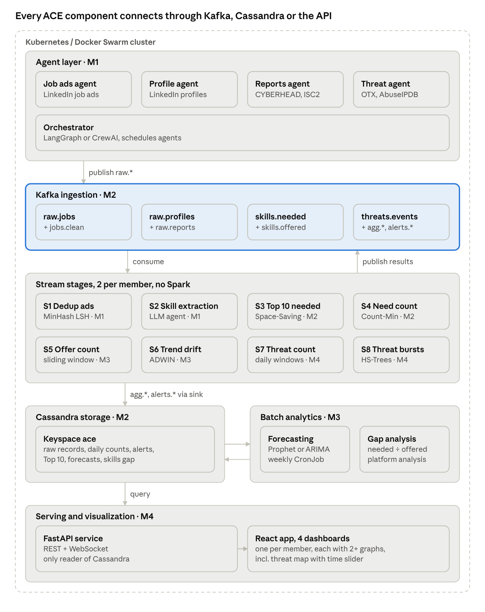

# ACE – Agentic Cybersecurity Education Optimizer: Project Design

Oct 19, 2026

## 1. Team

| | Member | Responsibility | Stream stages |
| --- | --- | --- | --- |
| M1 | Singh Multani Gurinder | Data agents, orchestrator, Skill Taxonomy | S1, S2 |
| M2 | Ullah Asad (team lead) | Kafka, Cassandra, deployment, monitoring | S3, S4 |
| M3 | Bailey Kelen | Forecasting, Skills Gap, LLM module | S5, S6 |
| M4 | Roomi Babar Ali | API, web app, Europe map, threat agent | S7, S8 |
| M5 | Richartz Lena | Education, workforce and platform agents | S9, S10 |

## 2. System description

ACE is a European counterpart to CyberSeek. For every country in the EU27, EEA, UK and Switzerland it shows which cybersecurity skills employers ask for (**Demand**), which skills professionals have (**Supply**), the **Skills Gap** (Demand ÷ Supply) and cyber threats, on choropleth maps and dashboards. The numbers match the architecture diagram in section 3:

1. **Online sources:** job ads (Adzuna and German Federal Employment Agency APIs, German job-ads history 2015–2026), the Stack Overflow Developer Survey, ENISA CYBERHEAD programmes, ISC2 reports, CyberSeek and ENISA ECSF, and the OTX and AbuseIPDB threat feeds.
2. **AI agents** each collect one kind of data; history is replayed in date order, so every window uses event time. A planning **orchestrator** (LangGraph or CrewAI) checks coverage per country every 6 hours and sends at most 5 collection tasks, each with a reason. Text is read by an LLM: Qwen via Ollama, Claude Haiku as fallback.
3. **Kafka** is the only way into the system. Messages are JSON, validated against shared schemas and keyed by country.
4. **Ten stream-mining stages** run as Apache Flink jobs (PyFlink and River, no Spark), read from Kafka and publish their results back. Every skill is mapped to one Skill Taxonomy based on the ECSF, so Demand and Supply can be compared.
5. A **sink** saves records and results in **Cassandra**, using query-first tables with replication factor 3.
6. **Batch jobs** forecast skill Demand 6–12 months ahead per country and for Europe (Prophet or ARIMA, LightGBM as challenger; retrained weekly or when S6 detects drift) and compute the monthly Skills Gap where at least 20 people have the skill (currently Germany, the UK and France).
7. A **FastAPI** service and a **React** app show a CyberSeek-style Europe map with a metric switch, one dashboard per member and a world threat map with scroll-back; alerts arrive live over WebSocket.

Every component runs in its own Docker container on Kubernetes (Docker Swarm as fallback); Prometheus and Grafana track pipeline health.

## 3. System architecture

## 4. Stream-mining tasks and algorithms

| Stage | Task | Algorithm | Input → output | Owner |
| --- | --- | --- | --- | --- |
| S1 | Remove near-duplicate job ads posted on several sites | MinHash + LSH | raw job ads → clean job ads | M1 |
| S2 | Extract skills, certifications and the ECSF role from text | LLM agent + Skill Taxonomy mapping | job ads, profiles → skills | M1 |
| S3 | Top 10 skills and certifications per country, last 30 days | Space-Saving, mergeable daily summaries | Demand skills → Top 10 | M2 |
| S4 | Daily Demand per skill and country (Demand map) | Count-Min Sketch, daily tumbling windows | Demand skills → daily counts | M2 |
| S5 | Supply per skill and country over the last 365 days | Exponential histograms (DGIM), sliding window | Supply skills → counts | M3 |
| S6 | Detect shifts in Demand; trigger forecast retraining | ADWIN | daily counts → drift alerts | M3 |
| S7 | Threat counts per country, hourly and daily | Tumbling windows | threat events → counts | M4 |
| S8 | Detect unusual threat bursts per country | Half-Space Trees | hourly counts → burst alerts | M4 |
| S9 | Find emerging skills not yet in the taxonomy | Lossy Counting, 30-day window | unmapped skills → candidates | M5 |
| S10 | Count distinct companies hiring per country | HyperLogLog, mergeable daily sketches | clean job ads → company counts | M5 |

## 5. Related work

CyberSeek is a useful reference for presenting cybersecurity workforce
intelligence through labor-market metrics and career pathways. Its data and
methodology focus on the United States, so ACE uses it as a product and
visualization reference rather than as a source of European country values
[1]. For European education, ENISA's European Cybersecurity Skills Framework
(ECSF) defines 12 role profiles with tasks, skills, knowledge and competences.
It provides a shared vocabulary for relating programmes to cybersecurity
roles, but a programme-to-role mapping still needs evidence from the programme
itself [2]. ISC2's annual Workforce Study adds survey-based evidence about
workforce size, skills shortages and hiring needs. Its figures should only be
reported at country level when the study provides an appropriate breakdown
and its year and methodology are retained [3].

ACE uses Lossy Counting in S9 to find frequent unmapped skill mentions with
bounded memory. Its results are taxonomy candidates, not automatically
approved entries [4]. S10 uses HyperLogLog, a mergeable cardinality estimator,
to estimate distinct hiring companies from daily country sketches over a
rolling 30-day period. This estimate is not an exact census [5]. The two
stages therefore have different semantics: S9 reports approximate mention
frequency, while S10 reports estimated distinct-company counts.

### References

1. CyberSeek. “Cybersecurity Insights.” <https://www.cyberseek.org/>
   (accessed 2026-11-02).
2. European Union Agency for Cybersecurity (ENISA). “European cybersecurity
   skills framework (ECSF) role profiles.” 2022-09-19.
   <https://www.enisa.europa.eu/publications/european-cybersecurity-skills-framework-role-profiles>
3. ISC2. “2024 ISC2 Cybersecurity Workforce Study: Global Cybersecurity
   Workforce Prepares for an AI-Driven World.” 2024.
   <https://www.isc2.org/Insights/2024/10/ISC2-2024-Cybersecurity-Workforce-Study>
4. G. S. Manku and R. Motwani. “Approximate Frequency Counts over Data
   Streams.” Proceedings of the 28th International Conference on Very Large
   Data Bases (VLDB), 2002, pp. 346–357.
   <https://www.vldb.org/conf/2002/S10P03.pdf>
5. P. Flajolet, É. Fusy, O. Gandouet and F. Meunier. “HyperLogLog: the
   analysis of a near-optimal cardinality estimation algorithm.” Discrete
   Mathematics & Theoretical Computer Science Proceedings, 2007.
   <https://algo.inria.fr/flajolet/Publications/FlFuGaMe07.pdf>
